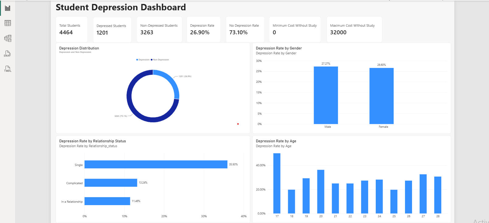

# Student Depression Analysis

An exploratory data analysis project using **SQL Server** and **Power BI** to examine patterns and factors associated with depression among students.

## 1. Project Overview

This project explores student depression data through SQL-based data cleaning, exploratory data analysis (EDA), and interactive Power BI dashboards.

The main objective is to understand how demographic, academic, financial, social, and health-related characteristics are associated with depression in the dataset.

## 2. Project Objectives

- Clean and prepare raw data for analysis.
- Explore the distribution of depression among students.
- Compare depression rates across different student groups.
- Investigate relationships between academic, financial, social, and health-related factors.
- Present key findings through interactive Power BI dashboards.

## 3. Dataset

The dataset used in this project was obtained from Kaggle.

- **Dataset Name:** Student Depression Detection Dataset
- **Source:** [Kaggle – Student Depression Detection Dataset](https://www.kaggle.com/datasets/mkhoirulmustaqim/student-depression-detection-dataset/data)
- **Platform:** Kaggle
- **Total Records:** 4,464 students
- **Target Variable:** Depression
- **Analysis Table:** `Student_Cleaned`

The dataset contains student-related information, including:

- Demographic characteristics
- Academic performance
- Financial background
- Living arrangements
- Relationship status
- Friend circle
- Health conditions

Please download the original dataset from Kaggle before running the SQL scripts.

**Note:** The database and cleaned table are not included in this repository. Users need to import the dataset and execute the SQL scripts to reproduce the analysis.

## 4. Tools & Technologies

| Tool | Purpose |
|---|---|
| SQL Server | Data cleaning and exploratory analysis |
| Power BI | Data visualization and dashboard development |
| DAX | Measures and calculated metrics |
| GitHub | Project documentation and version control |

## 5. Data Cleaning & SQL Analysis

SQL Server was used to prepare and analyze the dataset.

Key activities included:

- Checking missing values.
- Checking duplicate records.
- Validating data quality.
- Preparing the cleaned dataset.
- Using aggregate functions, conditional logic, CTEs, and window functions for analysis.

The cleaned data was stored in `Student_Cleaned` for further analysis in Power BI.

## 6. Power BI Dashboard

The dashboard consists of four pages.

### Page 1 – Overview

Provides an overview of the student population and overall depression distribution.

### Page 2 – Factors Analysis

Explores depression rates across different demographic and personal factors.

### Page 3 – Academic & Financial Analysis

Examines the relationship between depression and academic performance, study costs, and financial background.

### Page 4 – Social & Relationship Analysis

Explores depression rates across social and relationship-related categories, including Friend Circle and Relationship Status.

## 7. Key Findings

The analysis revealed several patterns:

1. **Overall Depression Rate:** 1,201 out of 4,464 students were classified as depressed, representing approximately 26.90% of the dataset.

2. **Gender:** Male students recorded a depression rate of 27.27%, compared with 26.60% among female students. The difference was relatively small.

3. **CGPA:** The CGPA group around 2.75 recorded a depression rate of approximately 42.96% (122 out of 284 students).

4. **Friend Circle:** The False group recorded a higher depression rate (34.27%) than the True group (24.04%). The meaning of these Boolean categories requires further verification.

5. **Relationship Status:** Single students recorded the highest depression rate among the relationship-status categories analyzed.

These findings describe patterns within the dataset and do not establish causal relationships.

## 8. Limitations

- The analysis is based on the available dataset and its recorded variables.
- Some categorical fields require further clarification of their definitions.
- The analysis identifies associations and differences, not causal relationships.
- The findings should not be interpreted as clinical diagnoses or individual mental health assessments.

## 9. Project Files

| File | Description |
|---|---|
| `Student_Depression_Analysis.sql` | SQL queries for data preparation and analysis |
| `Student_Depression_Dashboard.pbix` | Power BI dashboard |
| Dashboard PNG files | Screenshots of the four dashboard pages |

## 10. Conclusion

This project demonstrates a practical data analysis workflow using SQL Server and Power BI, from data preparation and exploratory analysis to dashboard development and insight communication.

It also provides a foundation for further learning in Python, statistical analysis, and more advanced data analytics techniques.

---

**Project Type:** Personal Data Analytics Portfolio Project  
**Tools:** SQL Server, Power BI, DAX
